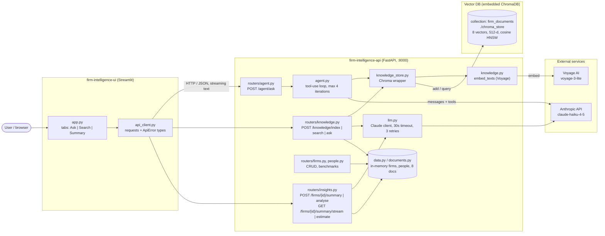
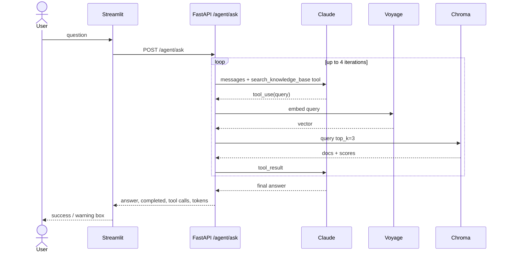
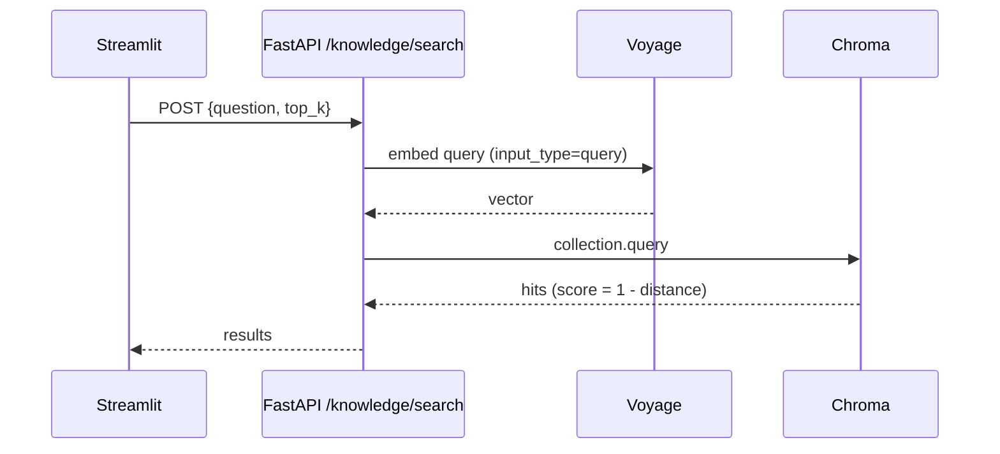
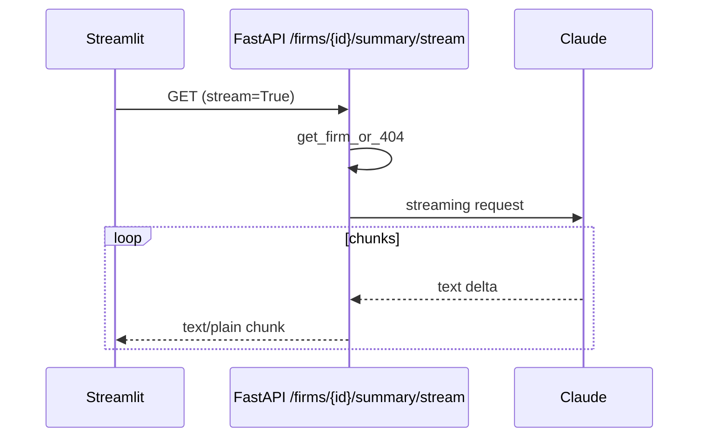

# Firm Intelligence – Architecture

A prototype with three parts: a Streamlit UI, a FastAPI backend and an embedded Chroma vector database. Claude (LLM) and Voyage AI (embeddings) are external services.

## Component diagram

Chroma runs inside the API process. There is no separate server, so uvicorn must be launched from `firm-intelligence-api/` for the relative `./chroma_store` path to resolve.

## Flows

### Ask (agent with tool use)

### Search only

### Streaming summary

### Indexing (manual)

`POST /knowledge/index` reads `DOCUMENTS` from `documents.py`, embeds each one with Voyage (`input_type="document"`) and upserts it into Chroma by id. There is no chunking, so each document is one vector.

## Components

| Part | Tech | Location |
|---|---|---|
| UI | Streamlit, requests | `firm-intelligence-ui/` |
| API | FastAPI 0.115, uvicorn | `firm-intelligence-api/` |
| Vector DB | ChromaDB 1.5 (persistent, embedded) | `firm-intelligence-api/chroma_store/` |
| LLM | Anthropic, `claude-haiku-4-5-20251001` | needs `ANTHROPIC_API_KEY` |
| Embeddings | Voyage AI, `voyage-3-lite` | needs `VOYAGE_API_KEY` |

## Current status

- The end-to-end demo works on paper: all three UI features map to live endpoints, and Chroma holds 8 indexed documents. This was read from the code, not run.
- `ui-implementation-explainer.md` is stale. `/agent/ask` is now wired.
- The UI's "index not built" (409) path is probably dead, because the Chroma store returns an empty list instead of raising.
- `test_agent.py` is unfinished, and its fake tool-use block has trailing commas that stop it working.
- Missing: an API `requirements.txt`, `.env.example`, a real README, and Docker or CI.
- The UI does not use `/knowledge/ask`, `/analyse`, or the firms and people CRUD.
